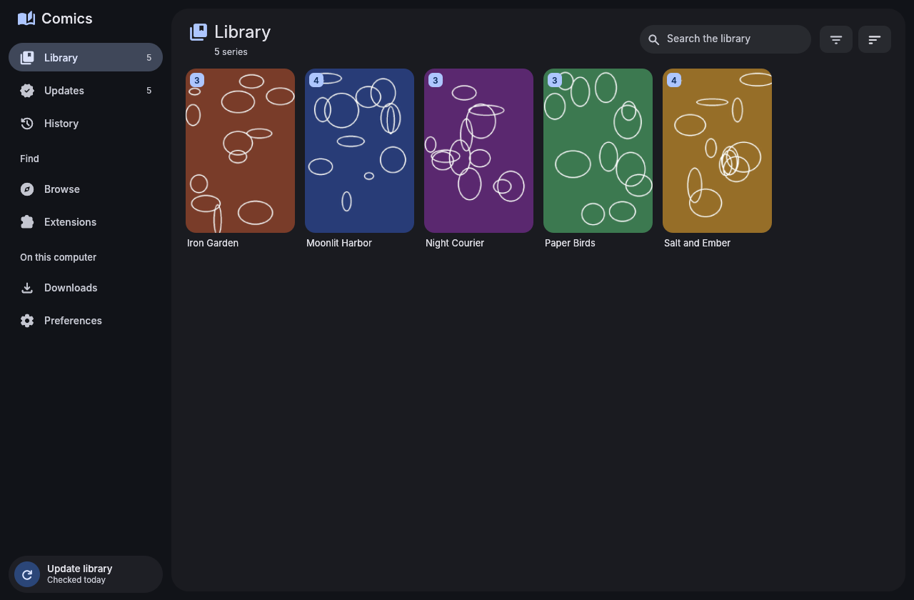
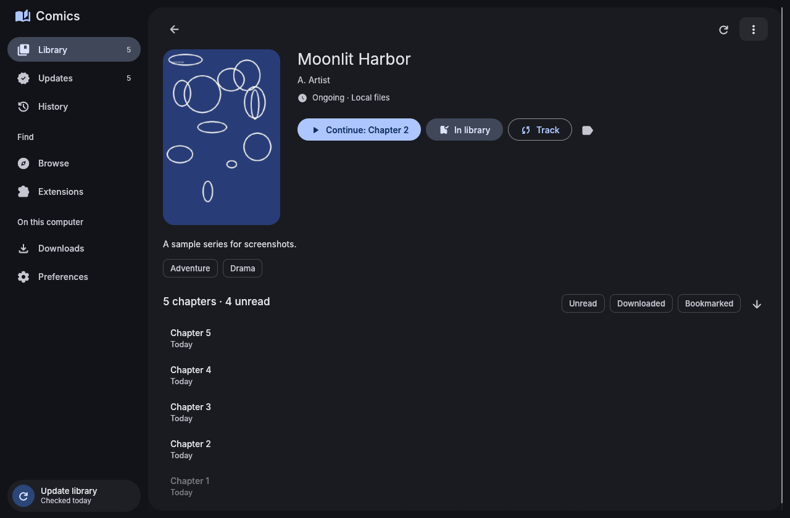
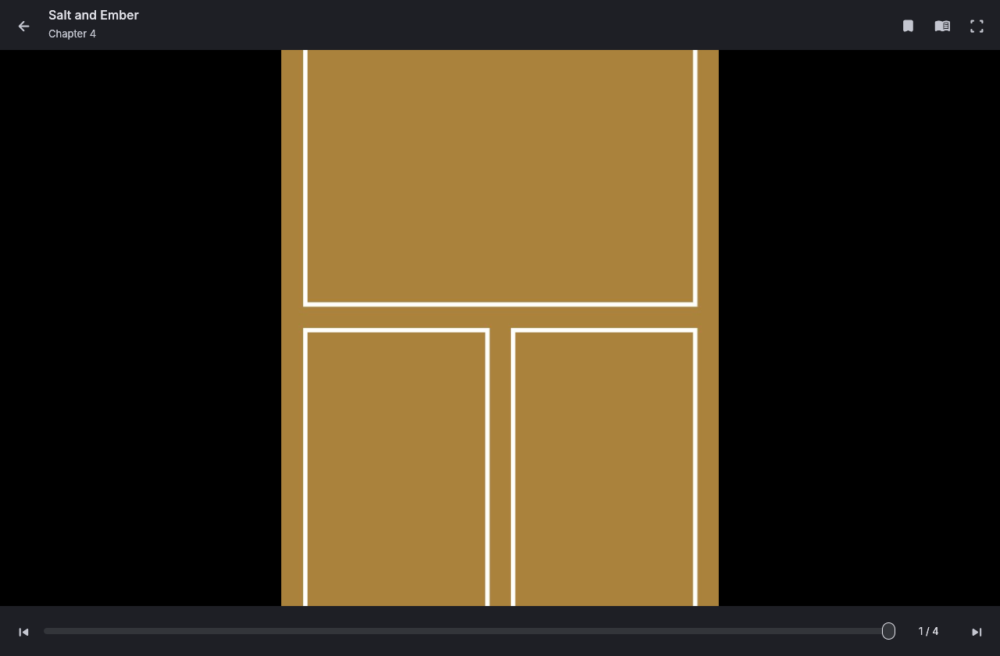
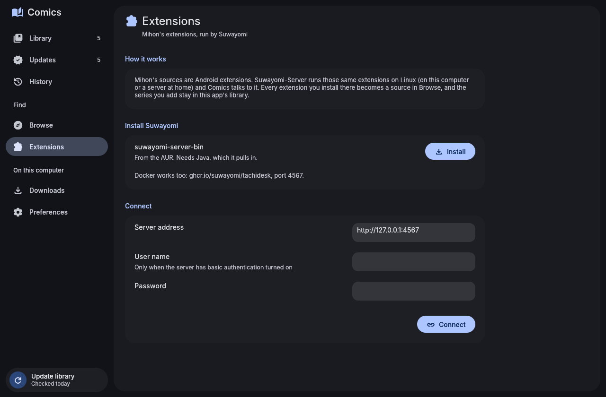

# Material 3 Comics

A manga and comics reader for Linux in the spirit of [Mihon](https://mihon.app), built with [egui](https://github.com/emilk/egui) and themed with Material You. It shares its look with the other Material 3 apps through [material-3-ui](https://github.com/bhimio1/material-3-ui), and on an end-4 desktop it takes its colors from your wallpaper, like the shell does.

Your library, updates, history and downloads work the way they do in Mihon. Sources are your own files, MangaDex, and every Mihon extension through [Suwayomi-Server](https://github.com/Suwayomi/Suwayomi-Server), which runs those extensions on Linux.






## Features

**Library**
- A cover grid with unread and downloaded badges, search, sorting (title, last read, date added, unread, latest chapter), filters (unread, downloaded, ongoing) and a cover size slider, all in the library's menus.
- **Categories** as tabs. Pick them when you add a series, and rename, reorder or delete them in Preferences.
- **Updates:** new chapters across the library, newest first. The library is checked on start once the update interval has passed, from the sidebar button, or in the background with a systemd timer. You can get a notification and download new chapters automatically.
- **History:** the last chapter read of each series, with the page you stopped on. Resume or remove each entry.

**Sources**
- **Local files:** folders of series in `~/Comics` (or any folders you add). Each series is a folder of chapters: CBZ, ZIP, EPUB, CBR, RAR, CB7, 7Z, CBT and TAR files, or folders of pictures. It reads Mihon's local-source extras: `cover.jpg`, `details.json` and `ComicInfo.xml`.
- **MangaDex,** built in: popular, latest and search, with your chapter languages, a content filter and data saver.
- **Mihon extensions through Suwayomi:** install, update and remove extensions from the Extensions page. Each one shows up as a source in Browse, with Mihon's languages and its NSFW flag. Comics keeps its own library, so the server only fetches things.
- **Global search** across every source at once, and pinned sources at the top of Browse.

**Series page**
- Cover, details, genres and status, with **Continue** to pick up where you left off.
- The chapter list has filters (unread, downloaded, bookmarked), sorting, and Ctrl/Shift-click selection to mark read, bookmark, download or delete in bulk.
- A per-series reading mode, Show in Files, and the series' web page.

**Reader**
- **Modes:** right to left (manga), left to right (comics), vertical, and webtoon (one long strip with no gaps). Each series can have its own mode.
- **Page fit:** screen, width, height or original size, on a black, gray, white or theme-colored background.
- **Tap zones:** click the left or right third to turn pages, or the middle for the menu. The menu has the chapter, a page slider, a bookmark button, the reading mode and fullscreen.
- **Moving between chapters:** a card between chapters, and an option to go straight on to the next one.
- **Preloading:** the next pages load while you read. Long webtoon strips are cut into pieces your GPU can show.
- **Progress:** saved on every page. A chapter counts as read when you reach its last page, and its download can be deleted after you read it.

**Downloads**
- Chapters are saved as CBZ files with `ComicInfo.xml`, so any reader (or the Local files source) can open them. They go in `~/.local/share/m3-comics/downloads/<source>/<series>/` unless you choose another folder.
- A queue you can pause, resume, retry or clear, and that survives restarts.
- Download the next 5 unread, all unread or all chapters from a series' menu.

**Tracking**
- **AniList:** link a series, and progress goes up as you finish chapters. You can also set the status and score yourself. The sign-in token stays in your keyring.

**Desktop**
- Open a comic file from the file manager, or drop one on the window. Its folder becomes a series, so its other chapters are there too.
- Show in Files opens [Material 3 File Manager](https://github.com/bhimio1/material-3-file-manager-rust) when it's installed.
- Optional tools can be installed from Preferences in a terminal.

## Keys

| Where | Keys |
|---|---|
| Anywhere | Ctrl+1–5 Library, Updates, History, Browse, Downloads · Ctrl+F or / search · Ctrl+R refresh · Alt+← or Backspace back |
| Reader, paged | ←/→ turn pages (in the reading direction) · Space/Shift+Space or PgDn/PgUp next/previous · Home/End first/last page · mouse wheel turns pages |
| Reader, strip | ↓/↑ or J/K scroll · Space, PgDn, → a screen down · Shift+Space, PgUp, ← a screen up |
| Reader | [ ] or P/N previous/next chapter · M menu · F or F11 fullscreen · Esc back |

## Install

From the AUR, prebuilt or built from source:

```sh
paru -S material-3-comics-bin   # or material-3-comics-git
```

On end4-pC, Material 3 Settings installs and updates it for you.

From this repository, with the included PKGBUILD:

```sh
cd packaging
makepkg -si
```

Prebuilt x86_64 binaries are attached to [releases](https://github.com/bhimio1/material-3-comics/releases).

Or build directly:

```sh
cargo build --release
./target/release/m3-comics [FILE | FOLDER]
```

`material_3_comics.desktop` registers Comics for CBZ, CBR, CB7 and CBT files, so you can make it the default in Material 3 Settings → Default apps, or with `xdg-mime default material_3_comics.desktop application/vnd.comicbook+zip`.

Optional tools:
- `libarchive` (`bsdtar`): CBR, RAR, CB7, 7Z and CBT files. CBZ, ZIP and EPUB need nothing;
- `libsecret`: keeps the AniList sign-in in your keyring;
- `suwayomi-server-bin`: Mihon's extensions (see below);
- `xdg-desktop-portal`: the folder pickers.

### Updates in the background

The packages ship a systemd user timer that checks the library twice a day, even when the window is closed, and sends a notification about new chapters:

```sh
systemctl --user enable --now m3-comics-update.timer
```

`m3-comics update` does the same once, from a terminal.

## Mihon extensions

Mihon's sources are Android extensions, so Comics doesn't run them itself. [Suwayomi-Server](https://github.com/Suwayomi/Suwayomi-Server) runs the same extensions on Linux, and Comics talks to its API:

1. Install the server: `paru -S suwayomi-server-bin` (the Extensions page has a button for this). Docker works too: `ghcr.io/suwayomi/tachidesk`, port 4567.
2. Start it (`suwayomi-server`, or its systemd service). By default it listens on `http://127.0.0.1:4567`.
3. In Comics, open **Extensions** and **Connect**. Fill in a user name and password only if you turned on basic authentication on the server.
4. Install extensions. Their sources appear in **Browse**.

The server can also run on another computer at home. Put its address in Extensions or Preferences → Sources.

## Tracking with AniList

AniList needs an API client of your own (it's free and takes a minute):

1. Open [AniList → Settings → Developer](https://anilist.co/settings/developer) and create a client. Set its redirect URL to `https://anilist.co/api/v2/oauth/pin`.
2. Put the client ID in Comics → Preferences → Tracking and choose **Sign in**. AniList shows a token. Paste it back into Comics.
3. On a series page, choose **Track** and pick the matching entry.

## Preferences

Preferences has:
- the shared Appearance card;
- the reader: default mode, page fit, strip width, background, page number, tap zones, going on to the next chapter, pages to preload;
- the library: folders for Local files, and categories;
- updates: the interval, notifications, downloading new chapters automatically;
- downloads: the folder, deleting chapters after reading;
- sources: MangaDex languages, data saver, extension languages, 18+ sources and series, the Suwayomi server;
- tracking: AniList, and updating progress automatically;
- optional tools.

**Auto** colors use end4-pC's generated palette (`~/.local/state/quickshell/user/generated/colors.json`) and follow it live. Preferences are stored in `~/.config/m3-comics/config.toml`. The library is in `~/.local/share/m3-comics/library.db` (SQLite), and covers are cached in `~/.cache/m3-comics`.

## Project layout

```
src/
  app.rs         window state, navigation, actions, background jobs
  reader.rs      the reader: paged and strip modes, menu, keys
  pages.rs       loading and decoding pages on worker threads
  db.rs          the library: series, chapters, categories, tracking (SQLite)
  downloads.rs   the download queue, CBZ files
  updates.rs     checking the library for new chapters
  tracking.rs    AniList
  covers.rs      cover thumbnails and their cache
  archive.rs     CBZ/ZIP/EPUB, CBR/CB7/CBT through bsdtar, ComicInfo.xml
  model.rs       series, chapters and pages as sources describe them
  config.rs      ~/.config/m3-comics/config.toml
  sources/       Local files, MangaDex, Suwayomi (Mihon extensions)
  ui/            sidebar, library, updates, history, browse, series, downloads, preferences
```

Run the tests with `cargo test`.

## License

MIT, see [LICENSE](LICENSE).

Fonts: Inter (SIL OFL 1.1, see `assets/fonts/LICENSE-Inter.txt`). Icons: Material Symbols, via `egui_material_icons`.

Comics isn't affiliated with Mihon, MangaDex, Suwayomi or AniList.
